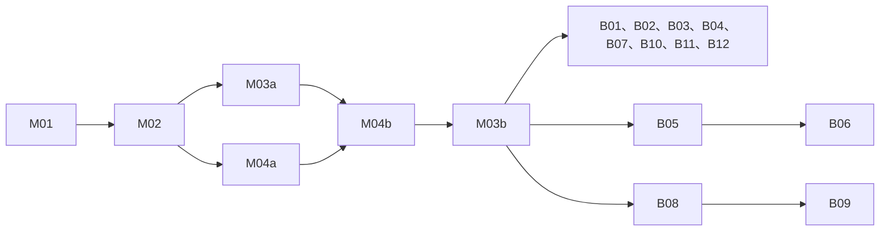

# Pi 迁移方案

日期：2026-10-17。状态：按复审意见修订，等待用户再次确认；全部工单保持 needs-triage，不开始 M01。依据为 [B01–B12](product-behavior.md)、[第 0 步报告](pi-step0-report.md) 和本次用户裁决。父工单 [#11](https://github.com/midcash/travel-regulation-rebuild/issues/11)。

最小实现是 Python 管理每个活跃会话的一个 Node 子进程，采用官方 Pi SDK 内存会话，SQLite 为唯一存储。复用现有供应商 HTTP 适配与网页结构，替换执行和交互内核。不保留长期双引擎兼容或产品假模型演示。完整迁移超过八个文件，本轮只做清理和规划。

## 第一批清理与依赖

清理前 HEAD `a23bce90349042ca0236332d342c8aeb0290fc6e` 已打 `legacy-pre-pi` 标签。检查主包、tests、第 0 步脚本及启动入口中的路径读取，再处理文档引用。

已删除 `docs/archive/`、`docs/hil-usage.md`、`docs/regression-baseline.md`、`docs/pi-step0-criteria.md`，未发现代码读取。`docs/pi-step0-results.json` 移入已忽略的 `artifacts/pi-step0/`，`verification/pi-step0/report.py:65` 改写入该位置；原始结果可从标签取回。`start-local.ps1` 删除 Provider/baseline 参数，固定 DeepSeek，该脚本原本没有独立 demo 参数。

以下因现有代码依赖延后，不能本轮直接删除：

- **experiments/**：`verification/pi-step0/replay.py:13` 读取 `experiment_2_hil_tools/results/sanya_live_20260910T094400`，`test_contracts.py:7` 导入回放，`run.py` 的 replay 命令调用它。第二批把回放及最小脱敏夹具迁到 `tests/e2e/`，切断引用后删除整个实验目录。
- **evals/**：`travel_agent/evaluation.py:73,77` 读取 cases/gates；`tests/test_travel.py:24` 直接读取 cases；`cli.py:62`、`server.py:154` 间接调用 evaluation。第二批移除旧评测、入口与对应测试后删除。
- **travel_agent/data/scenarios.json**：`domain.py:26` 读取，`scenario_by_id` 被 `cli.py:58`、`server.py:38,215`、`evaluation.py:83`、`verification/pi-step0/run.py:121` 及旧测试调用：`test_execution_state.py`、`test_hil*.py`、`test_integration.py`、`test_loop_contract.py`、`test_policy.py`、`test_travel.py`。第二批提取测试专用夹具、删除运行时场景入口后移除。
- **CLI 内部 baseline/demo 与网页旧控件**：`cli.py:25,31`、`server.py:70–77,124–154`、`web/app.js` 和旧 UI 测试仍依赖，不能只删参数而留旧默认值。与旧引擎同批移除；本轮只去掉启动脚本暴露的选项。

引用行号对应清理前标签，实施时用符号与路径复核。不得删除用户 SQLite、真实 Trace 或密钥。AGENTS 禁读目录约束针对开发检索，运行既定测试的夹具读取是明确例外。

## 批次与依赖

第一批清理已完成。第二批拆为六个基础子工单；M03b 完成前新链路只供开发验收，**不得切换 main.py、启动脚本、默认网页或 CLI 默认执行路径**：

1. M01：Node 运行进程、协议、隔离、压缩、模型注册、计量。
2. M02：Python 桥接、SQLite、工具适配、条件版本、按钮、取消，依赖 M01 协议。
3. M03a：新 server 接口、SSE、三栏页面与 CLI 接通，依赖 M02；用显式开发入口验收，保留默认旧入口。
4. M04a：回放迁 tests/e2e、最小脱敏夹具及桥接层回放。夹具和回放代码可与 M01/M02 并行准备；完成桥接回放验收依赖 M02，所以 Blocked by M02，不依赖 M03a 的 server/SSE。
5. M04b：完整 API/SSE 端到端测试、改口补测与预算校准，依赖 M03a 和 M04a。
6. M03b：真实三亚验收，成功后同批删除旧引擎和 domain 旧合同、切换默认入口，依赖 M04b。

第二批保持已有真实查询与成果展示能力；第三批 B 单可以并行，不以编号先后作为依赖。M03b 不宣称 B 场景全部通过。以下箭头表示完成验收的阻塞关系，M04a 准备工作可提前进行：



分组内各单只依赖 M03b；B06 通过 B05、B09 通过 B08 传递依赖 M03b。

```text
网页 / CLI → Python server / 会话服务 → SQLite（唯一存储）
                         ↕ NDJSON
                   Node Pi（按会话 ID）
                         ↕ 工具请求 / 精简结果
                Python 工具适配 → 供应商
Node 事件 → Python Trace / OTLP → SSE → 网页
```

## M01：Node 运行进程

生产代码放 `runtime/pi/`，SDK 及 lockfile 沿用精确锁定的 1.3.0，不直接运行 verification worker。每个活跃 conversation ID 独立进程、AgentSession、临时目录；单会话最多一个运行，多会话不能串入消息、steer、取消或候选。空闲进程可退出；每轮用 SQLite 完整 entries（含工具消息和压缩记录）重建内存会话，不保存 Pi 会话文件。

NDJSON 信封带 conversation_id、run_id、command_id、event_id、condition_version。命令为 init/prompt/steer/cancel/snapshot/shutdown，事件包括文本增量、工具请求、模型开始/结束、压缩、控制确认、错误。stdout 只发协议，stderr 脱敏；拒绝超大帧、错误会话和同 ID 不一致重投。

Node 工具 AbortSignal 必须经 tool_cancel 传到 Python，后者停止排队及可中止 HTTP。用户取消先由 Python 落库再通知 Node；Node 崩溃/退出也取消其 Python 任务。不能撤销的在途请求保留记录，迟到结果只归档、不应用当前状态；取消后不启动新模型/HTTP，十秒未结束则终止 Node，并保留未知用量。SSE 断线只退订，不取消运行。

资源全部使用内存 SettingsManager、CredentialStore、ModelsStore、ResourceLoader，modelsPath=null、禁刷新、无默认 coding tools/skills/extensions/MCP/shell/文件工具。空临时 cwd；HOME、USERPROFILE、APPDATA、LOCALAPPDATA、Pi 配置目录重定向空目录。仅传模型凭证，供应商密钥留 Python。

隔离禁止名单包括：仓库、祖先与真实用户目录中的 AGENTS.md、CLAUDE.md、GEMINI.md、SYSTEM.md；`.agents/`、`.pi/`、`.codex/`、`.claude/`、`.gemini/`、`.cursor/`；settings/models/auth 配置、`.env*`、`.git/`、experiments、artifacts，以及真实用户目录整体。只允许锁定依赖和专用临时目录等必要运行资源。挂钩 fs/fs.promises 的读写、扫描、open/stat/access/exists/stream/realpath/readlink 及同步变体；规范化 Windows 大小写、分隔符、file URL、父路径、符号链接/联接点实际目标。测试诱饵、祖先目录、真实 home 和联接绕过，断言零访问和主动拒绝；这是回归检测，不宣称恶意代码系统沙箱。

## M02：桥接、SQLite、工具

Python 增加小型进程桥接与会话服务，复用 telemetry 和供应商模块，不自写新 Agent loop。同会话命令串行，跨会话隔离。Windows 正常退出、管道损坏、强杀与重启均回收进程和临时目录。

只新增 pi_ 表与索引，不改旧表：

- pi_conversations：ID、条件版本、条件/选定项/成果快照、状态和时间。
- pi_messages：消息 ID、会话、角色、文本、捕获的上海时间、顺序、run；客户端消息 ID 在会话内唯一，重复提交回读。
- pi_entries：SDK entry ID/parent ID、会话、顺序、完整消息或压缩 JSON、SDK 版本；逐事件事务保存，不能只在整轮成功后快照。
- pi_runs：run、会话、状态、预算、usage_complete、时间/取消原因；重启将残留 running 标 interrupted，不自动续费执行。
- pi_tool_calls：查询 ID、run、工具名、实际参数、捕获版本、状态、结果证据 ID、时间；同 ID 不同参数拒绝。
- pi_evidence：证据 ID、查询/候选、来源、抓取时间、实际参数、版本、精简事实及私有原始结果。
- pi_events：会话递增序号、run、类型、脱敏 payload；供 SSE 重放和 Trace 关联，Node 重投幂等。

工具先登记 pending；供应商结果和证据同事务提交后才交 Node。返回但未提交、崩溃中的调用标 unknown，重查是新查询 ID；重复已完成调用只回读结果，不查供应商。保存实际查询参数，不能仅存用户抽象条件。

工具只返回 status、必要事实/候选、evidence_ids、queried_at、condition_version、实际参数和 warnings/error；不反复注入原始 JSON/Trace/政策全文。列表必须先应用用户航司、时间等有效条件，再排序并截取最多五条，不能先截五条再筛选。供应商支持的条件下推，不支持的在已获取数据上过滤，并明确分页/覆盖限制；不擅自扩大查询或把局部无匹配说成全市场无结果。需要更多走显式分页/查询。测试匹配项位于原列表第六条以后仍可返回。详情仅接受该会话已返回候选并校验证据归属。原始数据留私有 SQLite，模型和页面按 ID 读取必要投影。

首版会话级整数条件版本。明确采纳/修改递增，比较不变更选择。页面按钮经 Python 校验候选和证据所属会话后直接事务写库，expected_version 冲突为 409；运行中 steer，空闲仅落库、下一轮注入，不调用模型。旧版本工具结果归档，以实际参数与变化字段判断复用范围，不全盘丢弃，也不覆盖新条件。

每条用户消息接收时捕获上海时间（+08:00），作为相对日期解释基准；工具执行时按当前注入时钟再次拦截过去日期，覆盖跨午夜。历史解释不发在线查询。压缩后及恢复前从 SQLite 注入当前条件、选定项、引用证据 ID、查询时间和未完成问题；模型摘要不覆盖库内状态，恢复保留 DeepSeek reasoning/tool 消息结构。

## M03a：接口、页面、CLI 接通

保留回环绑定和现有同源安全校验。新接口：

- POST /api/conversations 创建；GET /api/conversations 列历史。
- POST /api/conversations/{id}/messages 接 client_message_id/text，返回 202、message/run ID、捕获时间与版本；运行中排入 steer，不开第二个 loop。
- GET /api/conversations/{id}/events 为 SSE，支持 Last-Event-ID；先提交再发送，不输出原始推理或私密数据；过期游标提示重新读取状态。
- GET /api/conversations/{id} 返回条件、选定项、成果/证据引用、版本、运行状态、用量和一致快照内的最新事件序号，避免取状态与订阅间漏事件。
- POST /api/conversations/{id}/selection 接 candidate_id/evidence_id/expected_version，事务直写；POST /api/conversations/{id}/cancel 幂等取消。

在显式开发入口中，左侧历史改会话、中间语义交互、右侧成果接新 API/SSE，刷新可恢复；新页面不用旧轮询/HIL 表单/固定场景/演示/评测控件。CLI 接入会话服务文本请求，可带 conversation ID；serve/trace 接通新服务。无密钥明确错误，不降级假模型。M03a 不改变默认入口，不删除默认旧页面/CLI 和引擎；这些删除与默认切换归 M03b。

## M03b：真实三亚验收与同批删除

完成条件依赖 M04b：正式 API/SSE 回放、改口补测及预算校准先通过。真实验收使用 M03a 的显式开发入口，不提前切换默认入口。

从页面提交当次未来日期的三亚出行，真实 Pi/DeepSeek/供应商完成现有去程、酒店、必要地点与接驳并进入成果区，来源/时间/证据可追查。记录提交版本、输入、Trace、截图与全部计量，不固定历史商品或报价，不预订。缺少真实凭证、服务失败或仅回放通过，均不能切换。

成功后同批删除 agent.py、hil.py、human.py、providers.py、request_parser.py、evaluation.py、旧 tools.py/demo prompt/data、evals、scenarios 及关联测试/API/UI。先做引用闭包：real_tools 的 schema helper、供应商使用的时区/fingerprint 等抽为小型共用事实工具，不把旧模块改名保留。domain.py 拆掉 normalize_request/scenario/四段 verdict/一晚格式合同，保留确实使用的事实校验，新会话与成果校验接管。供应商合同测试保留，混合测试提取有效断言后删除旧部分。

旧 HIL 只有本地测试数据，不做新历史投影或“旧版任务”功能。不修改、不删除旧表及记录即可；新会话回滚时暂不可见，但不删新表/数据。成功后的同批删除还包含旧默认页面控件、CLI eval/scenarios/baseline/demo/structured scenario 和 plan_trip 合同，最后切换默认入口。

## M04a：桥接层回放与夹具

replay.py 迁到 tests/e2e/replay.py，保留真正引用的最小脱敏历史夹具，记录源标签/路径和哈希；不复制无关实验或私人原始数据。默认自动发现运行无凭证测试；假模型只在 tests 注册，生产 runtime 不留 fake 开关。把第 0 步有价值的协议/进程/恢复断言迁为自动测试，依赖 baseline/HIL 的兼容探针改为测试专用夹具，清理不再使用的 verification 驱动，删除 experiments 引用。

M04a 回放经过正式 Python 桥接→Pi→工具边界→SQLite，不依赖 server/SSE；不能直连 step0 worker 冒充生产桥接。夹具和协议断言可先准备，M02 接通后完成桥接验收。默认假模型 token 不当作真实计量，付费模型测试显式启用。固定时钟告知模型，未知参数返回 NoHistoricalData 并计覆盖分母；真实测试用当次未来日期。

## M04b：完整 API/SSE 与改口计量

依赖 M03a/M04a，将同一测试环境扩展为正式 server→桥接→Pi→工具边界→SQLite→SSE/状态，覆盖真实路由和页面状态。改口和 token/调用次数校准在此完成，供应商边界使用回放。活跃时间 180 秒不能用回放校准，真实供应商耗时在 M03b 首次验证；若 M03b 超时则门禁失败，不切换默认入口，按实测调整受控配置、记录前后值和依据并重跑完整验收，不能在同一次超时运行中自动加额。M03b 的时间门禁不能冒充已经由 M04b 通过。

### 自动压缩和预算

锁定 SDK 原生阈值为 contextTokens > contextWindow - reserveTokens；第 0 步关闭自动触发，未验收产品阈值。正式首版启用 SDK 原生自动压缩，不在模型流回调中调用 AgentSession.compact()（它会先 abort 当前运行）。阈值 T=min(48,000, C - 16,384)，C 为核实后的窗口，配置 SDK reserveTokens=C-T、keepRecentTokens=6,000；超过 T 时由 SDK 在安全边界压缩。这里 16,384 是最小上下文余量，实际 reserveTokens 随 C 计算，不能仍写死 16,384 而声称 48,000 触发。普通输出上限 4,096，摘要独立上限 8,192，流适配强制上限并尊重 SDK 更小限制。第 0 步 131,072 只是测试窗口，不能当官方型号规格。

Node 每次模型请求前的预算估算涵盖系统提示、schema、待发消息、选择/证据注入和输出预留；预算拦截不递归调用压缩。SDK 一次压缩提交后重新预检，同一边界再次触发或仍不足则明确停止；失败/截断不应用摘要，不反复压缩。SDK 上下文溢出后的恢复请求也须走相同预检，失败不再重放。工具续轮和摘要请求均受限，不只检查用户入口；剩余额度不足支付压缩和回答时停止，不偷偷扩额。启动时要求 C 大于 16,384+6,000，否则拒绝该配置，不能使用负阈值或无法保留近期历史的配置。

初始每请求上限维持：12 次模型、20 次工具、30 次 HTTP、80,000 累计 token、180 秒活跃时间、单模型 45 秒。80k 包含缓存命中的输入，是所有模型请求的 input+cacheRead+cacheWrite+output 之和（有原始 usage 时与 prompt_tokens+completion_tokens 交叉校验，推理不重复加）。这是累计用量上限，不是上下文窗口大小或未命中 token 上限。摘要/重试/取消/恢复继续都计量，工具 schema 拒绝另记尝试数。运行中 steer 归原 run，不重置预算；新空闲请求新开预算，会话另累计。测试阈值前/等于/后、工具增长、长历史恢复、截断、取消和额度不足，断言证据不丢、无压缩循环。

[预算核对](pi-budget-audit.md) 给出逐次来源：394,607 token/104 工具是四类各三次、共十二次累计；正常完整工具覆盖回放两次为 27,936/36,487 token。全部正式样本最高 49,196 只证明已测短历史成本，不能证明多轮后段的 80k 足够。选择方案 a：缓存命中输入继续计入预算，不采用只计未命中输入与输出的方案 b；同一长上下文会反复计入累计用量，缓存也不一定稳定命中。保留统一口径，避免预算随缓存状态跳变或掩盖长历史成本。

M01 必须实现含缓存的计数、逐次请求预检与停止原因，不能因本轮是恢复/后续消息而忽略历史输入或重置同一 run。M04b 除首轮完整覆盖回放和三类改口各 3–5 次外，增加多轮后段矩阵：实际待发上下文约 30–36k、42–48k 两档，在 B05 式修改、B08 式服务重启恢复后继续查询、B09 式隔日核验当前价格三种情境中，各发起需要查询的请求，目标覆盖 2–3 次业务模型调用，压缩额外计数，实际更多也保留；每档每种情境至少三次，共至少十八次。历史应来自相关多轮消息、工具结果、选定项/证据和压缩记录，不能用无关填充文本替代；先准备前序会话，单独计量后段新请求，不把准备用量混入。若实际阈值 T 小于 48k，两档按 T 的 62.5%–75%、87.5%–100% 等比例取值，并记录实际 token。必须记录新请求加入后的待发上下文、每次模型的未命中/命中输入与输出、压缩前后规模、摘要成本、模型/工具次数和预算拦截；前置压缩或实际跨阈值也纳入，不把被拦截样本剔除。

全部首轮、改口和多轮后段样本进入同一门禁：模型/工具/历史 HTTP/token 的最大样本乘 1.25（token 再加下一回答 4,096 预留）不超过配置；后段被预算拦下本身就是校准失败，先有据调整预算或压缩配置并重测全部受影响样本，不自动加额或改掉缓存口径。80k 仍是待校准初始值，不据首轮结果认定足够。活跃时间不在回放门禁中证明，180 秒在 M03b 真实供应商首次验证，超时按上述门禁失败处理。真实供应商不可预知失败仍可触发限额，达到限制不能记三亚验收通过。

### 单一重试责任

模型网络重试仅由 Node 模型请求适配负责；SDK provider/agent 重试关闭，Python 不重发 prompt。仅 429、可恢复 5xx 或尚无流输出的连接失败最多重试一次，尊重 Retry-After、超时和总预算；流已输出后中断不自动重试，记 usage incomplete，等待继续。认证、参数、上下文超限不重试。

供应商自动重试首版为零，由 Python 统一控制，检查并关闭 supplier_wire/httpx 隐式重试。模型看到失败后重新查询是新工具/HTTP、新 ID，照常限额；unknown 不自动重放。压缩失败无额外重试层。Trace 记录每次尝试、重试原因与次数。

### 模型价格注册与观测

使用已验证的 deepseek-flash，正式启动核对配置型号，不自动换型号。官方内存 provider 注册包含已核实 contextWindow/maxTokens、input/output/cacheRead/cacheWrite 价格、币种、每百万 token 单位、来源和生效时间。价格放非密钥版本配置，校验非负和单位，不沿用零价占位。实施时核对 [官方价格](https://api-docs.deepseek.com/quick_start/pricing) 与账号 API；若别名无对应计价依据，金额 unknown，不能声称零费用。

Node 回传原始及 Pi usage，Python Trace/OTLP 关联会话/run/request/query/version。总输入=input+cacheRead，reasoning 已含 output，不重复加；缺 cache-write 和中断最终 usage 记未知。区分模型/摘要/重试/工具/HTTP 和 usage_complete。推理仅在私有恢复 entries 保留所需结构，不向 SSE/OTLP 导出原文。

### 改口补测

已有 redirect 三次聚合数据，但缺少 steer 边界拆分、在途未知用量和所有工具尝试计量，不能证明中途改口完整成本。补“模型流式时改口”“工具在途改口”“连续两次改口”，每类真实 DeepSeek 跑 3–5 次；确定性测试覆盖迟到工具、取消和重启。

逐次报告改口前后模型次数、工具尝试/执行/HTTP、输入/缓存/输出/推理、摘要 token、耗时、旧版本复用/丢弃和未知用量；关联 steer 接收/提交/消费事件及条件版本。无高铁历史数据明确缺失并计覆盖，不能拿低覆盖定产品预算；展示全部范围与失败，据此重定预算。

## 第三批：逐项 B 验收

每项独立子工单引用 product-behavior 对应段落，新增正反例并清理关联旧业务约束。B01/B02/B03/B04/B05/B07/B08/B10/B11/B12 只依赖 M03b，可并行；B06 依赖 B05（明确采纳后的修改处理），B09 依赖 B08（隔日恢复后解释历史），均传递依赖 M03b。工具/状态机制已由 M02 提供，不能仅因共享文件或编号相邻增设业务阻塞关系：

1. B01 部分查询与航司条件：解除强制完整方案前置字段。
2. B02 只追问必要字段：解除无关会议/预算/返程/住址必填。
3. B03 有理由的主要推荐与替代：选定项优先。
4. B04 同会话转向和跳过：复用 steer/版本，不恢复 HIL 阶段门。
5. B05 明确修改和冲突裁决：解除核心需求不可变约束。
6. B06 比较不采纳：假设不写选定状态。
7. B07 当天/不住/多晚/返程：清理 transport/stays/places/route 的前一日、一晚、会议角色与固定两路线限制，保留事实与衔接校验。
8. B08 刷新/重启/隔日：消息、entries、选择、成果一致恢复，不自动续费。
9. B09 历史与当前：按证据解释、按实际参数重查，刷新价格不换选择。
10. B10 制度与预算：去掉默认随包政策和默认全员适用。
11. B11 部分失败：保留可靠成果，区分失败/缺输入/无匹配，未知费用不为零。
12. B12 范围和选定含义：允许自身问答，不预订/付款/锁库存。

## 验收与回滚

清理批次运行现有 Python、三项 Node UI 和第 0 步合同测试；检查文档链接、删除路径引用、忽略目录及标签。第二批 tests/e2e 取代旧 baseline 自检，覆盖正常、认证/供应商失败、无历史数据、冲突/重复提交、崩溃、流式中断、取消、压缩失败、恢复和资源访问拒绝。

真实切换需要现有 DeepSeek、途牛、高德凭证，分别用于模型、交通住宿、地点路线，不新增账号，不输出密钥。真实三亚失败不切换。切换成功并同批删除后，可回滚 legacy-pre-pi 恢复旧程序；新增表保留，新旧用户数据都不删改。B01–B12 未逐项通过不能宣称产品全部完成。

## 本轮清理验证

132 项 Python 回归、三项 Node UI 检查、10 项第 0 步合同测试通过。启动 PowerShell AST 检查通过，仅保留 Port 参数；变更文档链接、标签目标、Git 忽略规则检查通过。移走的 JSON 与标签原件内容相同（Git LF 与 Windows 检出 CRLF 归一后逐字节一致）。本轮没有重跑付费模型和真实供应商，也没有实施正式 Pi 接入。

## 复审修订核验

本轮从标签原件重算十二次累计和逐次缓存用量，校验本地副本一致；检查四份变更文档链接、18 个子工单链接、正文与原生依赖无环及标签保持 needs-triage，均通过。仅修改文档与工单，没有执行付费模型/供应商或修改生产代码；未重复运行上一批的 Python/UI 回归。等待用户审阅确认后再改标签并开始 M01。

## GitHub 子工单

- [M01 · 正式 Node 会话进程、隔离与模型计量](https://github.com/midcash/travel-regulation-rebuild/issues/12)
- [M02 · Python 桥接、SQLite 会话与精简证据工具](https://github.com/midcash/travel-regulation-rebuild/issues/13)
- [M03a · 新接口、SSE、页面三栏与 CLI 接通](https://github.com/midcash/travel-regulation-rebuild/issues/14)
- [M04a · 桥接层回放迁移与最小脱敏夹具](https://github.com/midcash/travel-regulation-rebuild/issues/15)
- [M03b · 真实三亚验收及同批删除旧引擎与 domain 旧合同](https://github.com/midcash/travel-regulation-rebuild/issues/28)
- [M04b · 完整 API/SSE 端到端测试与改口预算校准](https://github.com/midcash/travel-regulation-rebuild/issues/29)
- [B01 · 按当前查询交付](https://github.com/midcash/travel-regulation-rebuild/issues/16)
- [B02 · 只追问当前必要信息](https://github.com/midcash/travel-regulation-rebuild/issues/17)
- [B03 · 有理由的推荐](https://github.com/midcash/travel-regulation-rebuild/issues/18)
- [B04 · 在同一会话转向](https://github.com/midcash/travel-regulation-rebuild/issues/19)
- [B05 · 明确修改与条件冲突](https://github.com/midcash/travel-regulation-rebuild/issues/20)
- [B06 · 比较不等于采纳](https://github.com/midcash/travel-regulation-rebuild/issues/21)
- [B07 · 需要的行程形态](https://github.com/midcash/travel-regulation-rebuild/issues/22)
- [B08 · 刷新与重启后继续](https://github.com/midcash/travel-regulation-rebuild/issues/23)
- [B09 · 历史依据与当前核验](https://github.com/midcash/travel-regulation-rebuild/issues/24)
- [B10 · 制度与预算分开](https://github.com/midcash/travel-regulation-rebuild/issues/25)
- [B11 · 部分失败仍交付可靠成果](https://github.com/midcash/travel-regulation-rebuild/issues/26)
- [B12 · 业务范围与选定的含义](https://github.com/midcash/travel-regulation-rebuild/issues/27)
